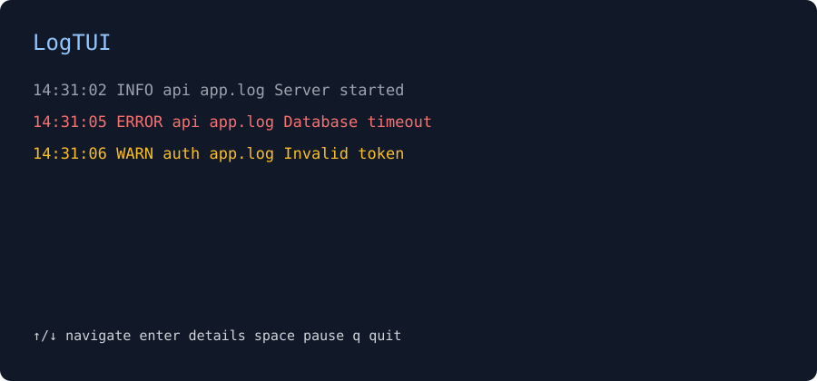

# LogTUI

> A fast terminal UI for exploring and filtering logs.

**[Website](https://jvrlc.github.io/logtui/)** ·
**[Getting started](#install)** ·
**[Contributing](CONTRIBUTING.md)**

LogTUI reads local log files, normalizes JSONL and plain-text entries, and follows
new lines in a navigable terminal table. It is local-only and needs no server.

```bash
logtui app.log
logtui api.log worker.log
```



## Install

Python 3.12 or newer is required.

```bash
pip install .
# or
pipx install .
```

For development:

```bash
python -m venv .venv
. .venv/bin/activate
pip install -e '.[dev]'
pytest
```

## Usage

```bash
logtui app.log
logtui api.log worker.log --buffer-size 20000
```

JSON objects are mapped to timestamp, level, service, and message. Extra fields
remain available in the detail view. Unknown or invalid formats safely become
plain text.

### Keyboard shortcuts

| Key | Action |
| --- | --- |
| `↑` / `↓` | Navigate |
| `Enter` | Open log details |
| `Space` | Pause/resume display |
| `j` / `k` | Navigate using Vim-style keys |
| `?` | Open keyboard help |
| `q` | Quit or close details |

## Roadmap

The next milestones add stdin (`docker logs -f ... | logtui -`), text search,
an independently tested query language, headless JSONL output, and exports.

The package is separated into sources, parsing, models, buffer, and TUI layers so
future Docker, Kubernetes, journald, and custom parser integrations can remain
optional.

## Contributing

Run `pytest`, `ruff check .`, `ruff format --check .`, and `mypy` before opening a
change. Focused bug reports and small, tested pull requests are welcome.
